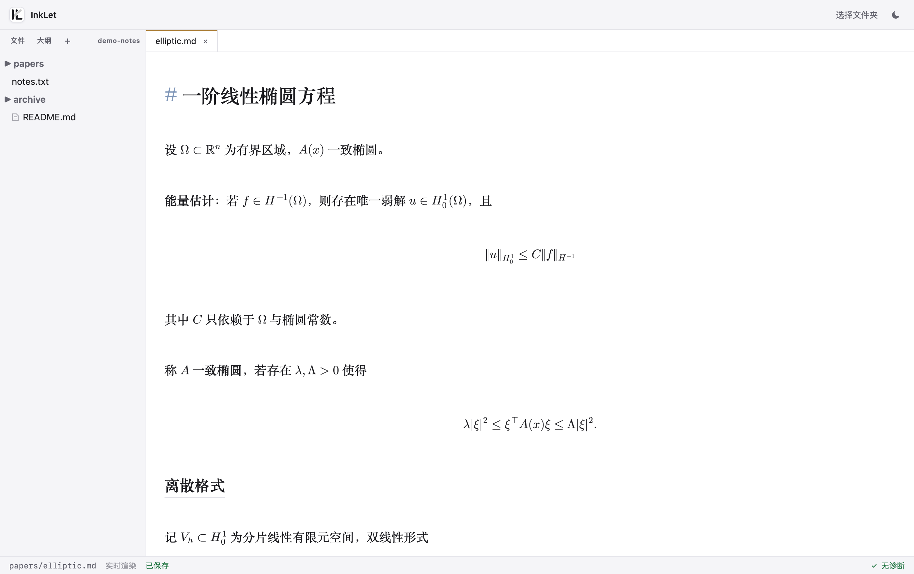
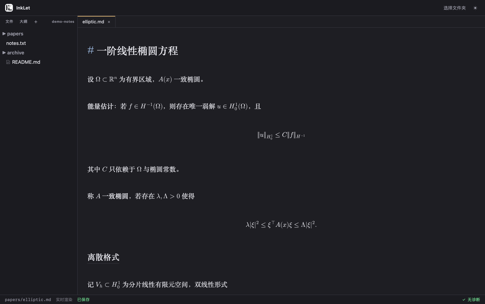
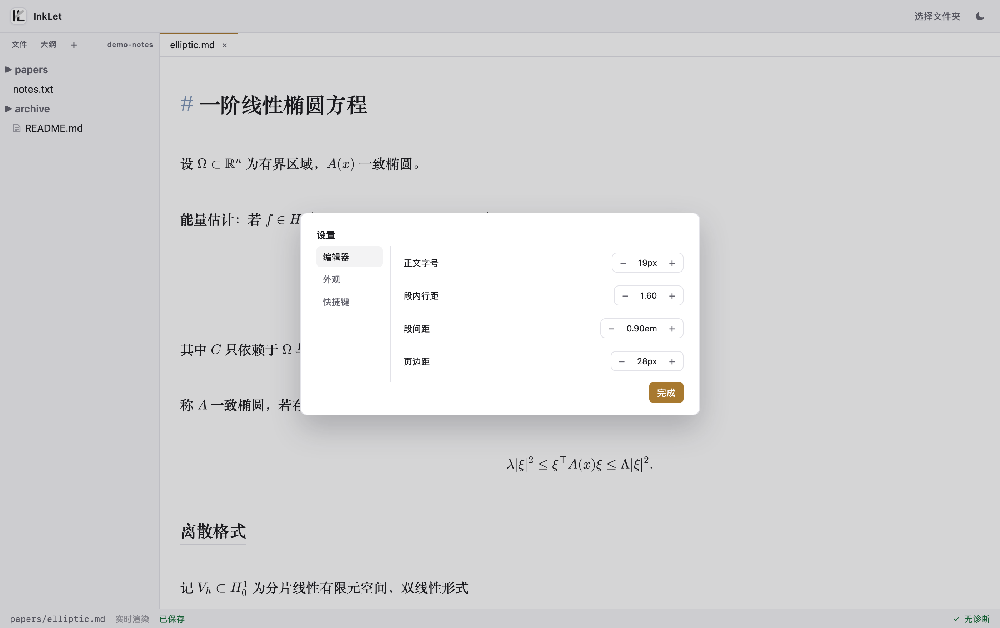

<div align="center">


# InkLet（墨点）

**面向学术写作的 Markdown 编辑器：公式照 LaTeX 写，文件仍是普通的 `.md`，写完直接导出 PDF**

[](LICENSE)
[](https://tauri.app/)
[](#下载)
[](https://github.com/isKage/InkLet/releases)
[](https://github.com/isKage/InkLet/pulls)

</div>

InkLet 想解决的是 LaTeX 的排版能力与 Markdown 的写作成本之间的落差：写的时候看到的是排好版的样子，而不是一堆符号。文件就是普通的 `.md`，没有数据库，也不依赖专有格式。



## 功能

**写作**

- 实时渲染：光标离开标记就渲染成成品样式，回到标记上又变回源码
- 两种视图：实时渲染（`⌘1`）或左右对照（`⌘2`）
- 数学：行内公式 `$…$`，行间公式 `$$…$$` 或 `\[…\]`；在 `$$` 后按回车会自动补上闭合符，需要编号时写 `\tag{2.1}`
- 代码块：输入三个反引号后按回车自动补全，`⌘⌥C` 选择语言，16 种语言高亮，导出 PDF 时保留
- 表格：点单元格直接改，`⌘↵` 加一行
- 注释：`> ` 开头的行渲染成灰色注释块，适合放旁注和推导提示
- 链接：`[文字](网址)` 支持省略 `https://`；`[文字](note.md)` 打开工作区里的文件；`<id:xxx>` 做文内锚点，`[文字](#xxx)` 跳转（按住 `⌘` 点击）
- 大纲按标题跳转，文件树按文件夹管理

**文件**

- 把文件夹或 Markdown 文件拖进窗口，就切换工作区
- 右键文件：创建副本、复制（真实文件进系统剪贴板，可到 Finder / VS Code 粘贴）、复制文件路径、重命名、删除
- 从 Finder 复制文件或文件夹，回窗口按 `⌘V`，递归粘贴到当前文件夹；同名自动编号，不覆盖
- 图片和 PDF 可以直接在应用里预览

**界面**

- 四套配色：浅色、暖纸、蓝灰、深色
- 正文字号、行距、段间距、页边距、界面缩放都可以调
- 界面语言：中文 / English
- 内置终端：右上角入口，默认进入当前文件夹；`✕` 收起（进程保留），垃圾桶结束会话，可拖动上沿调整高度

**输出**

- 导出 PDF：先渲染成自包含 HTML，再调用本机的 Chrome 或 Edge 打印
- 图片、公式、代码高亮都内联进 HTML；链接和文内锚点在 PDF 里同样可以点击

<div align="center">


</div>

## 下载

安装包在 [Releases](https://github.com/isKage/InkLet/releases) 页面。

| 平台 | 文件 | 安装 |
| --- | --- | --- |
| macOS（Apple Silicon） | `InkLet_x.y.z_aarch64.dmg` | 打开后把 InkLet 拖进「应用程序」 |
| Windows（64 位） | `InkLet_x.y.z_x64-setup.exe` | 双击安装，默认装进当前用户目录 |

### 首次打开会被系统拦一下

这个版本没有代码签名，两个平台都会提示：

**macOS** 会提示「无法验证开发者」。在「应用程序」里按住 Control 点按 InkLet，选「打开」，再确认一次；或者执行：

```bash
xattr -dr com.apple.quarantine /Applications/InkLet.app
```

**Windows** 会弹 SmartScreen，点「更多信息 → 仍要运行」。

装好之后，Finder 或资源管理器里右键 `.md` 文件可以看到「打开方式 → InkLet」。

## 从源码运行

需要 macOS 或 Windows、Node 22.12 以上、pnpm，以及 Rust 工具链。Rust 可以装在仓库内（`.toolchains/`，不进 git），不动系统的 Rust：

```bash
bash scripts/packaging/install-rust.sh     # 首次；已有 rustup 可跳过
pnpm install
pnpm dev:tauri                             # 桌面窗口，带热更新
```

只想看界面的话，桌面应用也能跑在浏览器里，此时没有文件系统访问，只有一个内存里的示例工作区：

```bash
pnpm --filter @inklet/desktop dev          # http://localhost:5174/#demo
```

检查：

```bash
pnpm check              # 类型、lint、单元测试、打包冒烟
pnpm test:rust          # Rust 侧的命令测试
pnpm ui:check           # 无头浏览器跑界面断言并截图
```

## 打包

```bash
pnpm package:mac        # macOS：产出 .dmg
pnpm package:win        # Windows：产出 NSIS 安装包 .exe（+ .msi）
```

安装包会被放进仓库根目录的 `dist/`（已在 `.gitignore` 里）。每次打包都会先清空 `dist/`，所以里面只可能是这一次编译的结果。

这两个脚本只编译和复制文件，不会把应用装到本机，也不会打开它。Windows 包必须在 Windows 上构建，Tauri 不能从 macOS 交叉编译。

## 目录结构

```
apps/desktop              桌面应用（前端 + src-tauri/Rust 外壳）
apps/playground           开发用的语法树 / 数学渲染调试页（pnpm dev）
packages/academic-md-core Markdown 方言的解析、分析与 HTML 渲染
packages/editor-ui        CodeMirror 实时渲染、widget、主题
packages/math-render      MathJax 包装（SVG，同步，离线）
scripts/assets            应用图标源文件（mark.svg）与生成脚本
scripts/packaging         打包（mac / win）与 Rust 工具链安装
scripts/dev               启动桌面窗口
scripts/test              Rust 测试、界面截图检查
docs/releases             每个版本的发布说明
```

界面上所有固定文案在 `apps/desktop/src/i18n.ts`，中英文各一份。应用图标由 `scripts/assets/mark.svg` 生成，改完跑 `pnpm icon`。

## 已知限制

- 只提供 Apple Silicon 的 macOS 包和 64 位 Windows 包，没有 Intel Mac 版本
- 导出 PDF 依赖本机安装 Chrome 或 Edge
- 没有文件监视：别的程序改了文件，保存时会提示冲突，需要手动重新载入
- 每个窗口只能打开一个工作区（文件夹）
- 内置终端使用系统 shell（macOS 为 `$SHELL`，Windows 为 `COMSPEC`），尚未在 Windows 上充分测试

## 发布说明

每个版本的说明放在 [docs/releases](docs/releases)。当前版本：[0.1.0](docs/releases/v0.1.0.md)。

## 许可证

InkLet 以 [GNU General Public License v3.0](LICENSE) 发布。

用到的第三方组件（Tauri、CodeMirror、MathJax、highlight.js、Lezer、xterm.js 等）许可见 [THIRD_PARTY_NOTICES.md](THIRD_PARTY_NOTICES.md)。
